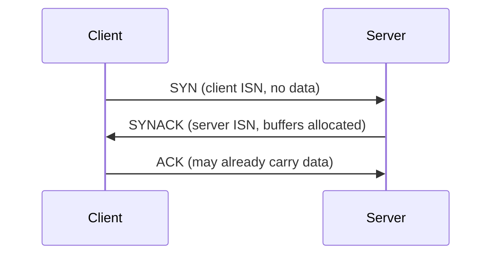
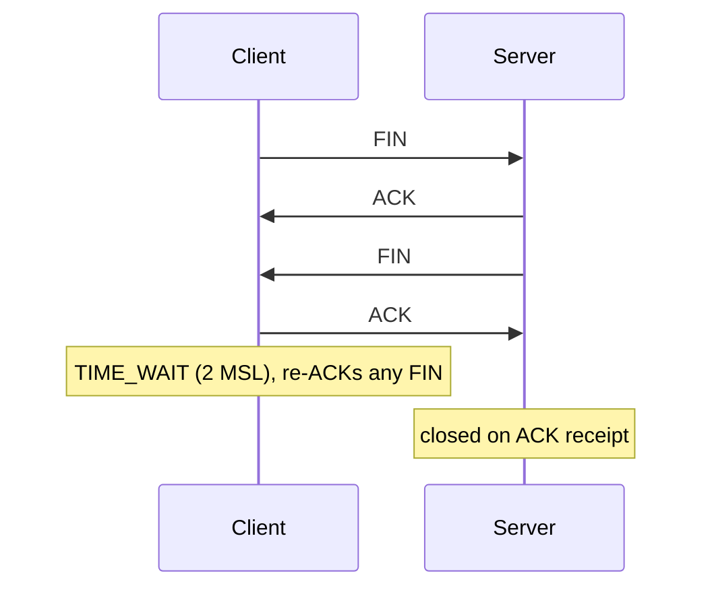
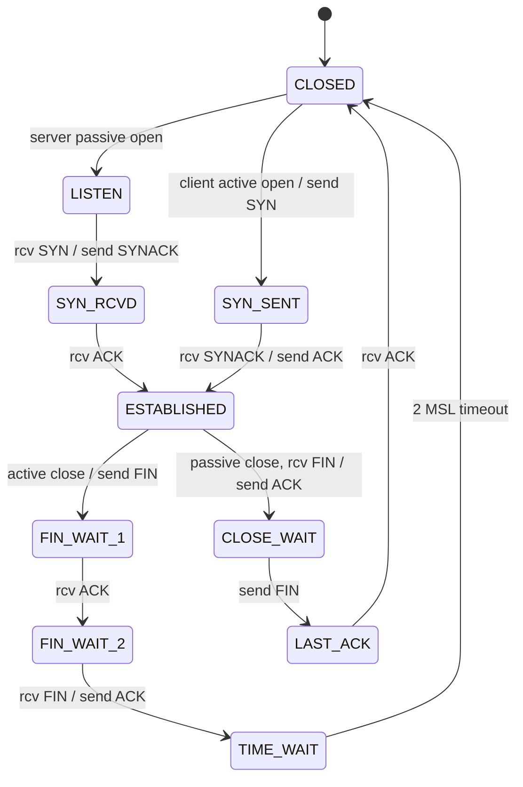

Before exchanging data, both hosts initialise TCP variables : sequence numbers, buffers, flow control info.

## Opening : three-way handshake

ISN = Initial Sequence Number.

## Closing : 4 segments
Full duplex → the two directions are closed independently.

## State diagram (simplified)

## TIME_WAIT (2MSL wait)
**MSL** = Maximum Segment Lifetime (30–120 s).
| Why wait | Side effect |
|---|---|
| resend the last ACK if it was lost | the socket 4-tuple can't be reused (issue for busy servers) |
| old delayed segments are not mistaken for a new connection | |

## Full HTTP example
SYN → SYNACK → ACK → GET → object → FIN/ACK exchanges ; sockets `IP_Client:49997 ↔ IP_Server:80`.

**Links** : [[TCP Segment Structure]] [[HTTP Connections]]
