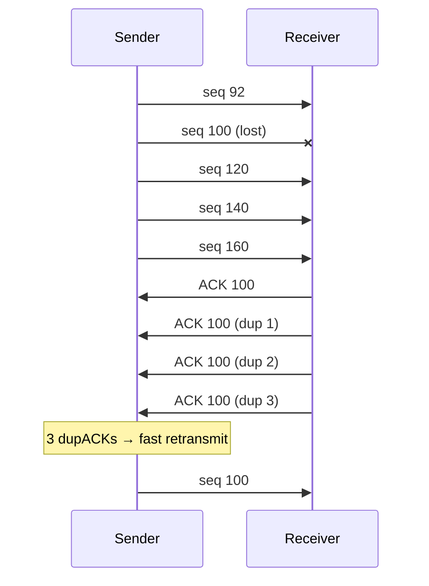

TCP builds reliability on top of unreliable IP with : pipelined segments, **cumulative ACKs**, a **single retransmission timer**. Retransmission triggered by **timeout** or **duplicate ACKs**. Mix of [[Pipelined Protocols|Go-Back-N]] (cumulative ACK, one timer) and Selective Repeat (receiver may buffer, only one segment resent).

## Simplified sender — 3 events
| Event | Action |
|---|---|
| Data from app | create segment (seq = byte number), start timer if not running (timer = oldest unACKed segment) |
| Timeout | resend the segment that caused it, restart timer |
| ACK y > SendBase | new data ACKed : SendBase = y, restart timer if segments still unACKed |

## Retransmission scenarios
| Scenario | What happens |
|---|---|
| Lost ACK | timeout → segment resent, receiver drops duplicate |
| Premature timeout | resent too early, cumulative ACK covers both |
| Cumulative ACK | ACK 120 lost but ACK 140 arrives → covers everything, no resend |
| Repeated timeouts | **exponential backoff** : timeout doubled at each retransmission |

## ACK generation (RFC 5681)
| Event at receiver | Action |
|---|---|
| In-order segment, all previous data ACKed | **delayed ACK** : wait up to 500 ms for a second one |
| In-order segment, one ACK pending | send one cumulative ACK for both immediately |
| Out-of-order segment (gap) | send **duplicate ACK** immediately (next expected byte) |
| Segment filling the gap | ACK immediately |

## Timeout value
Too short → premature timeouts, useless resends. Too long → slow reaction to loss.

| Formula | Role |
|---|---|
| SampleRTT | time segment → ACK, ignoring retransmissions (**Karn's algorithm**) |
| EstimatedRTT = (1 − α)·EstimatedRTT + α·SampleRTT, α = 1/8 | smoothed mean (exponential weighted moving average) |
| DevRTT = (1 − β)·DevRTT + β·\|EstimatedRTT − SampleRTT\|, β = 1/4 | variability |
| **TimeoutInterval = EstimatedRTT + 4·DevRTT** | mean + safety margin |

Initially EstimatedRTT = 0 s, DevRTT = 3 s.

## Fast retransmit
Timeouts are long. One lost segment in a burst → many duplicate ACKs.
**3 duplicate ACKs** for the same data → resend the next segment **before** the timer expires.

**Links** : [[Pipelined Protocols]] [[TCP Segment Structure]] [[TCP Congestion Control]]
