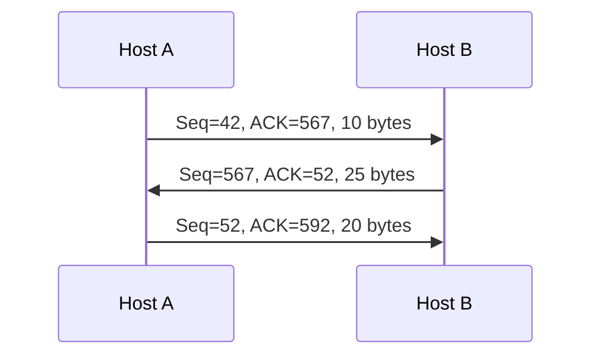

## TCP in a nutshell
| Feature | Meaning |
|---|---|
| Point-to-point | one sender, one receiver |
| Full duplex | data in both directions on one connection |
| Reliable, in-order **byte stream** | no message boundaries |
| Connection-oriented | handshake sets up states first → [[TCP Connection Management]] |
| Pipelined | window size set by flow + congestion control |
| Buffers | send and receive buffers |
| MSS | Maximum Segment Size (max app data per segment) |

## Header (20 bytes)
| Field | Role |
|---|---|
| Source / destination port | [[Multiplexing and Demultiplexing\|demultiplexing]] |
| Sequence number | number of the **first byte** of data (counts bytes, not segments) |
| ACK number | **next byte expected** from the other side |
| Header length | |
| Flags : URG, PSH | urgent / push now (rarely used) |
| Flag ACK | ACK number is valid |
| Flags SYN, FIN, RST | setup, teardown, reset |
| Receive window | bytes the receiver accepts → [[TCP Flow Control]] |
| Checksum | same as [[UDP]] |

**Piggybacking** : the ACK for data A→B travels inside a data segment B→A.

## Sequence and ACK numbers

- B acks 52 = 42 + 10 → "I got bytes up to 51, send 52"
- A acks 592 = 567 + 25
- Out-of-order segments : TCP RFCs give no rule (buffer or drop = implementation choice)

## Review question
Seq 90 then seq 110 → first segment holds **20 bytes**. If the first is lost and the second arrives, B sends **ACK 90** (still waiting for byte 90).

**Links** : [[TCP Connection Management]] [[TCP Reliable Data Transfer]] [[TCP Flow Control]] [[The Network edge]]
