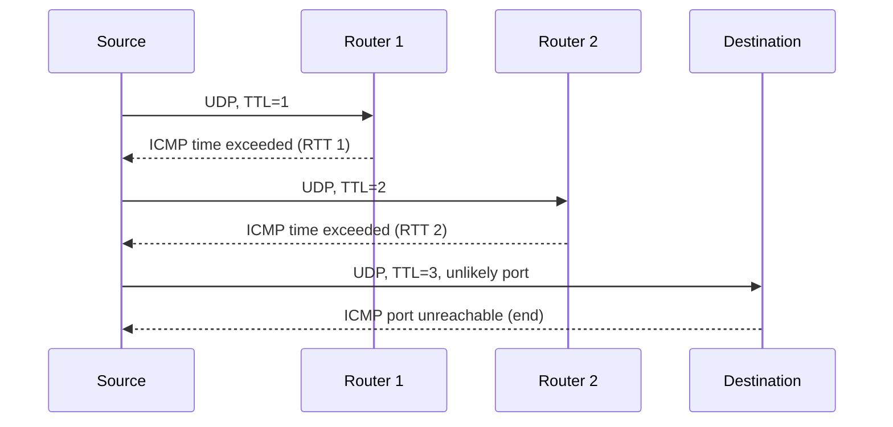

Tool measuring the real delay to each router on the path to a destination.

1. Sends UDP datagrams to the destination with an unlikely port number and **increasing TTL** (1, 2, 3...)
2. Each router where the TTL expires answers with ICMP **"time exceeded"** → gives its address + RTT
3. The destination answers with ICMP **"port unreachable"** → end

- 3 probes per hop, `* * *` = no answer
- Big jump in RTT = long link (e.g. intercontinental cable)
- Large-scale measurements : RIPE Atlas

**Links** : [[Nodal Delay]] [[ICMP]]
