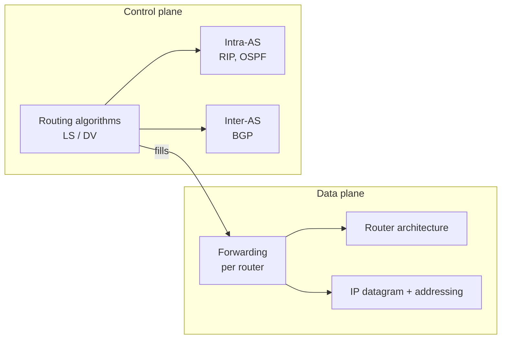

Chapter 5 — L. Schumacher (UNamur), based on Kurose & Ross.

## 1. Introduction
Network layer runs in every host and router. Two key functions : **forwarding** (local, input → output) and **routing** (global, compute the path). The Internet offers only best effort ; ATM offered guaranteed services over virtual circuits.
→ [[Network Layer Services]] · [[Virtual Circuit networks]] · [[Datagram networks]] · [[Best Effort]]

## 2. Inside a router
Input ports (lookup at line speed), switch fabric (memory, bus, crossbar), output ports (queueing, scheduling). Queues → loss, HOL blocking ; RED drops early.
→ [[Router Architecture]]

## 3. Internet Protocol
| Topic | Key idea | Note |
|---|---|---|
| Addressing | address = interface ; prefix + host ; CIDR, longest match prefix | [[IP Addressing]] |
| Prefix allocation | PA vs PI ; ISPs aggregate customer prefixes | [[Route Aggregation]] |
| IPv6 | 128 bits, fixed 40 B header, extensions, SLAAC | [[IPv6]] |
| Security | AH / ESP, transport / tunnel mode, SA | [[IPsec]] |
| Forwarding | same network → direct ; else next hop ; TTL−1 ; match + action (SDN) | [[IP Forwarding]] |
| Configuration | discover / offer / request / ack | [[DHCP]] |
| Address sharing | one public IP, ports in a translation table | [[NAT]] |
| Control messages | errors, ping, traceroute ; ICMPv6 does neighbor discovery | [[ICMP]] |
| Transition | dual stack, tunnelling, NAT64 | [[IPv4 to IPv6 Transition]] |

## 4. Routing principles
Network = graph, find the least-cost path. **Link state** (global view, Dijkstra) vs **distance vector** (neighbours only, Bellman-Ford, count to infinity). For scale and autonomy, routers are grouped into **autonomous systems**.
→ [[Routing Algorithms]] · [[Dijkstra Algorithm]] · [[Distance Vector]] · [[Autonomous Systems]]

## 5. Routing in the Internet
| Protocol | Scope | Algorithm | Transport |
|---|---|---|---|
| [[RIP]] | intra-AS | distance vector (hops, max 15) | UDP 520 |
| [[OSPF]] | intra-AS | link state (Dijkstra), areas | IP protocol 89 |
| [[BGP]] | inter-AS | path vector, policy | TCP 179 |

Intra-AS cares about **performance**, inter-AS about **policy**.

## Review questions
- What is the difference between forwarding and routing? → [[Network Layer Services]]
- Why does a router need to look up faster than 5 ns, and what is HOL blocking? → [[Router Architecture]]
- What is an IP network? What is CIDR and why did it replace classes? → [[IP Addressing]]
- How can an ISP advertise a single prefix for all its customers? → [[Route Aggregation]]
- Compare the IPv4 and IPv6 headers. → [[IPv6]]
- An application sends 40 bytes of data every 20 ms over TCP. What is the header overhead with IPv4 and with IPv6? → [[IPv6]] (50 % vs 60 %)
- Difference between AH and ESP? What is a security association? → [[IPsec]]
- How does host A send a datagram to a host on another network? → [[IP Forwarding]]
- Why is NAT controversial? → [[NAT]]
- How does traceroute use ICMP? → [[ICMP]] · [[Traceroute]]
- Why can't IPv6 be deployed in one day, and how does tunnelling work? → [[IPv4 to IPv6 Transition]]
- Run Dijkstra from A on the example graph. → [[Dijkstra Algorithm]]
- What is count to infinity, and does poisoned reverse solve it? → [[Distance Vector]]
- Compare link state and distance vector algorithms. → [[Routing Algorithms]]
- Why is routing hierarchical? What is hot potato routing? → [[Autonomous Systems]]
- Compare RIP and OSPF. → [[OSPF]]
- Why does inter-AS routing differ from intra-AS routing? → [[BGP]]
