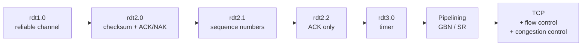

## 1. Transport-layer services
- [[Transport Layer Services]] : logical communication between processes ; TCP, UDP, SCTP, DCCP, QUIC

## 2. Connection
- [[Multiplexing and Demultiplexing]] : UDP socket = 2-tuple, TCP socket = 4-tuple
- [[UDP]] : no frills, 8-byte header, checksum
- [[TCP Segment Structure]] : byte stream, sequence and ACK numbers, flags, piggybacking
- [[TCP Connection Management]] : three-way handshake, 4-segment teardown, TIME_WAIT
- [[QUIC]] : connection IDs, migration, encrypted short headers and frames

## 3. Reliability
- [[Reliable Data Transfer]] : rdt1.0 → rdt3.0, ARQ, stop-and-wait
- [[Pipelined Protocols]] : SAW utilisation, Go-Back-N vs Selective Repeat
- [[TCP Reliable Data Transfer]] : cumulative ACK, timeout = EstimatedRTT + 4·DevRTT, fast retransmit

## 4. Speed matching (flow control)
- [[TCP Flow Control]] : RcvWindow protects the receiver's buffer

## 5. Congestion control
- [[Congestion Control Principles]] : 3 scenarios, end-to-end vs network-assisted, ECN
- [[TCP Congestion Control]] : CongWin, slow start, AIMD, ssthresh, BDP, CUBIC, BBR
- [[TCP Fairness]] : AIMD converges to R/K, UDP and parallel connections break it
- [[TCP Latency Model]] : 2 RTT + O/R + idle time due to slow start

## Where each mechanism lives
| Mechanism | UDP | TCP | QUIC |
|---|---|---|---|
| Multiplexing (ports) | yes | yes | yes (+ connection ID) |
| Error detection (checksum) | yes | yes | yes (encryption) |
| Connection setup | no | 3-way handshake | 1-RTT / 0-RTT |
| Reliability (ACK + retransmission) | no | yes | yes, per stream |
| Flow control | no | RcvWindow | stream + connection |
| Congestion control | no | CongWin | yes (e.g. BBR) |
| Header | 8 B | 20 B | short header + frames |

## From rdt to TCP

## Review questions
- Why choose UDP rather than TCP? → [[UDP]] (no setup delay, no state, small header, no throttling)
- Reliable transfer over UDP? → [[UDP]] (reliability added in the application, e.g. QUIC)
- Segments with seq 90 then 110 : data in the first? ACK if the first is lost? → [[TCP Segment Structure]] (20 bytes, ACK 90)
- How does ssthresh evolve on timeout? → [[TCP Congestion Control]] (CongWin / 2, CongWin back to 1 MSS)
