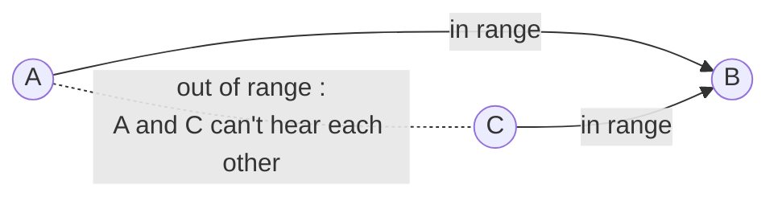
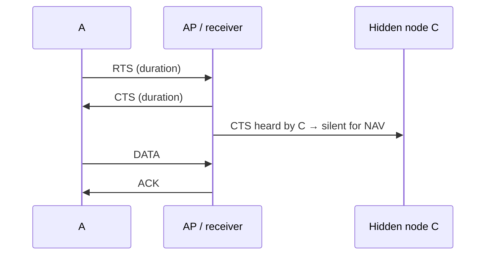

Random access for **wireless** : sending and receiving at the same time is very costly (except full-duplex radios) → **no collision detection**. Idea : **avoid** collisions instead.

## Algorithm
| Side | Rule |
|---|---|
| Sender | channel idle for **DIFS** (Distributed Inter Frame Space) → send the whole frame |
| | channel busy → **backoff** (DIFS + random time, doubled each time the channel is busy) |
| Receiver | frame OK → **ACK** after **SIFS** (Short Inter Frame Spacing) |

ACK is required because the sender can't detect collisions.

**NAV** (Network Allocation Vector) : the sender announces the **duration** of its transmission → other nodes know how long to stay silent.

## Hidden terminal problem

A and C both send to B → collision at B, and neither detection nor avoidance helps (they don't hear each other).

## RTS / CTS (reservation)

RTS and CTS are **short** → a collision between them costs little.

**Links** : [[Random Access Protocols]] [[Multiple Access Protocols]] [[Wireless access networks]]
