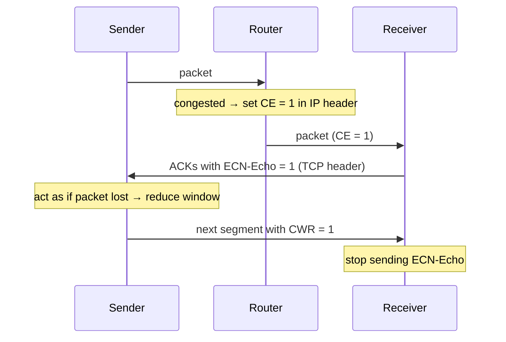

**Congestion** = too many sources sending too much data too fast for the **network** (≠ flow control, which protects the receiver).
Symptoms : **lost packets** (router buffer overflow) and **long delays** (queueing).

## 3 scenarios
| # | Setup | Result |
|---|---|---|
| 1 | 2 connections, 1 router, **infinite** buffer, no retransmission | max throughput R/2 each, but **delay explodes** near R/2 |
| 2 | 2 reliable connections, **finite** buffer, retransmissions | offered load λ'in > λin : useless retransmissions of delayed packets waste capacity |
| 3 | multihop, connections compete on shared links | when traffic grows, throughput → 0 : packets dropped late waste **upstream** resources |

λin = original data rate, λ'in = original + retransmissions, λout = useful throughput.

## 2 strategies
| End-to-end | Network-assisted |
|---|---|
| no feedback from the network | routers send feedback to end systems |
| congestion inferred from loss and delay | 1 congestion bit, or explicit rate |
| standard TCP (1980s) | ECN, ATM, DCTCP (2010) |

## ECN — Explicit Congestion Notification (RFC 3168)

CE = Congestion Experienced, CWR = Congestion Window Reduced.

**Links** : [[TCP Congestion Control]] [[Queueing Delay]] [[Packet Loss]] [[TCP Flow Control]]
