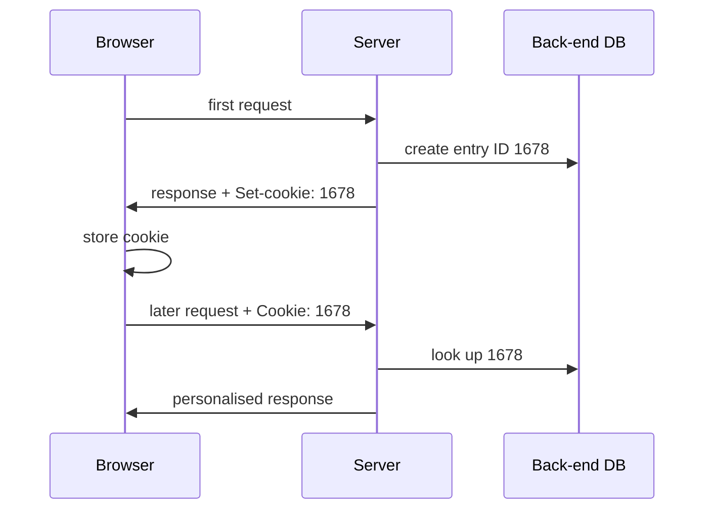

[[HTTP]] is stateless, but sites want content based on the user (banking, shopping cart, recommendations) → **cookies** keep state.

## 4 components
1. `Set-cookie` header line in the HTTP **response**
2. `Cookie` header line in the next HTTP **requests**
3. Cookie file on the user's host, managed by the browser (max 300 cookies of 4 kB)
4. Back-end **database** on the server

| Session cookie | Permanent cookie |
|---|---|
| deleted at end of session | kept until expiry date |

Third-party cookies (e.g. ad servers) → tracking across sites.

## Browser fingerprinting
Cookies are regulated (GDPR) → trackers built from hardware, OS, display and browser settings (test : amiunique.org).

**Links** : [[HTTP]]
