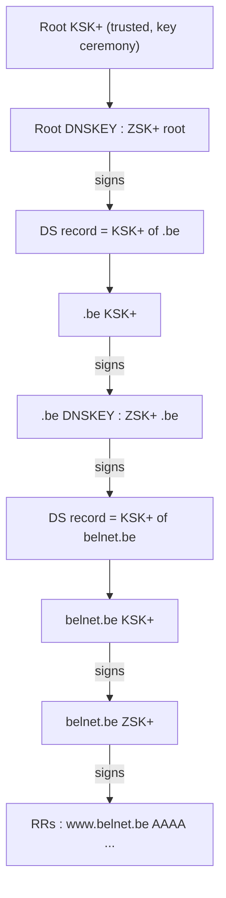

## Problem : cache poisoning
An attacker injects a forged answer into a resolver's cache → users are sent to a fake IP (Kaminsky, 2008).

## Solution : DNSSEC (RFC 4033)
**Signed** DNS replies + key management through a **chain of trust**.

### Island of security (one zone)
Goal : validate the RRs of an authoritative server.
- RRs signed with the **Zone Signing Key (ZSK)**

| New RR | Content |
|---|---|
| RRSIG | signature of an RR (type, algorithm, expiry, signature) |
| DNSKEY | public key $ZSK^+$ (and $KSK^+$) of the zone |
| NSEC | proves a name does not exist (counter-measure to zone survey) |
| DS | hash of the child's $KSK^+$, stored in the parent zone |

### Chain of trust (from the root down)
Each zone has 2 key pairs : **KSK** (Key Signing Key) signs the DNSKEY set, **ZSK** signs the other RRs.

Issue : key renewal.

## Try it
- `dig www.belnet.be RRSIG` · `dig belnet.be DNSKEY`
- `delv @9.9.9.9 +vtrace www.belnet.be AAAA` · dnsviz.net

**Links** : [[DNS]] [[DNS Records]] [[Certification Authority]] [[Hash Functions]]
