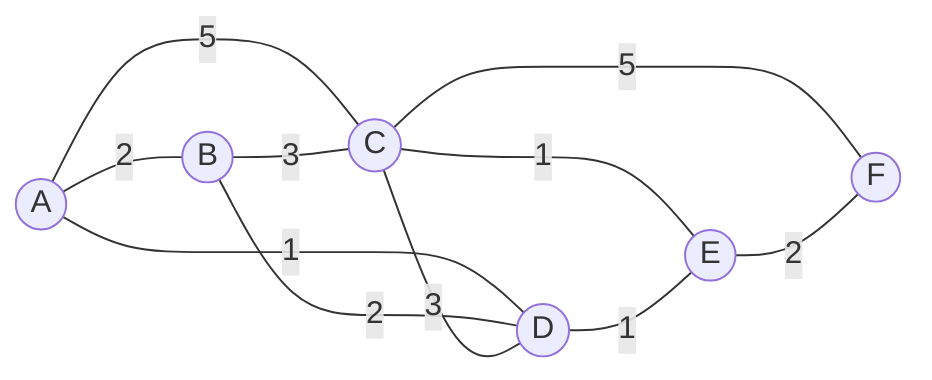

**Link state** algorithm : topology and link costs known by all nodes (**link state broadcast**), each node computes the least-cost paths to all others. Iterative : after k iterations, the least-cost paths to k destinations are known.

## Notation
| Symbol | Meaning |
|---|---|
| c(i,j) | link cost from i to j (∞ if not neighbours) |
| D(v) | current cost of the path from the source to v |
| p(v) | previous node on that path |
| N | nodes whose least-cost path is final |

## Algorithm
```
Initialisation
  N = {A}
  for all nodes v : D(v) = c(A,v) if v adjacent to A, else infinity
Loop
  find w not in N with minimum D(w)
  add w to N
  for all v adjacent to w and not in N :
      D(v) = min( D(v), D(w) + c(w,v) )
until all nodes in N
```
New cost to v = old cost, or best cost to w + cost from w to v.

## Example (source A)

| Step | N | B | C | D | E | F |
|---|---|---|---|---|---|---|
| Init | A | 2, A | 5, A | **1, A** | ∞ | ∞ |
| 1 | A, D | **2, A** | 4, D | | 2, D | ∞ |
| 2 | A, D, E | | 3, E | | **2, D** | 4, E |
| 3 | A, D, E, B | | **3, E** | | | 4, E |
| 4 | A, D, E, B, C | | | | | **4, E** |
| 5 | A, D, E, B, C, F | | | | | |

(E and B tie at 2 : E picked arbitrarily.) Bold = node added at that step.

## Resulting forwarding table of A
Follow the predecessors back until the first hop :

| Destination | Cost | Path | Next hop |
|---|---|---|---|
| B | 2 | A-B | B |
| C | 3 | A-D-E-C | D |
| D | 1 | A-D | D |
| E | 2 | A-D-E | D |
| F | 4 | A-D-E-F | D |

> Link costs of the graph rebuilt from the table (classic Kurose & Ross graph).

## Discussion
- Complexity : n nodes → (n−1) + (n−2) + ... = n(n+1)/2 comparisons → **O(n²)** (O(n log n) with a heap)
- **Oscillations** possible when link cost = carried traffic : routes flip back and forth. Fix : don't use traffic as cost, avoid routers recomputing at the same time (self-synchronisation)

**Links** : [[Routing Algorithms]] [[Distance Vector]] [[OSPF]]
