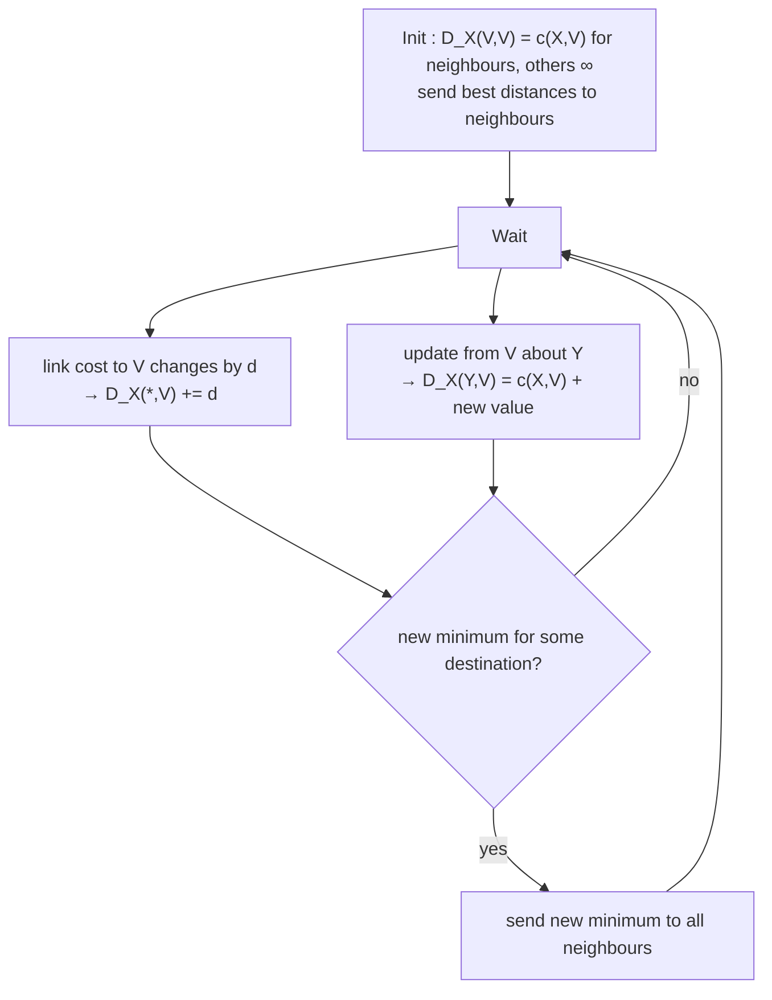

## Properties
| Property | Meaning |
|---|---|
| Iterative | continues until neighbours stop exchanging, self-terminating |
| Asynchronous | updates triggered by a local change or a message from a neighbour |
| Distributed | each node talks **only to direct neighbours** |

## Distance table
Each node X keeps a table : one **row per destination**, one **column per neighbour**.
$$D^X(Y, Z) = c(X, Z) + \min_w D^Z(Y, w)$$
= cost from X to Y if the first hop is neighbour Z.
The column with the smallest value in a row gives the **next hop** → routing table.

## Bellman-Ford (at each node X)

## Link cost changes
| Good news (cost decreases) | Bad news (cost increases) |
|---|---|
| **travels fast** : a few exchanges and done | **travels slow** : count to infinity |

## Count to infinity
X–Y cost 4 → 60, Y–Z cost 1, Z–X cost 50.
- Y still believes Z reaches X in 5 (via Y itself!) → **routing loop** : Y routes to X through Z, Z routes through Y
- Costs go up by small steps : 6, 7, 8... → loop broken only after **44 iterations**

## Poisoned reverse
If Z routes to X **through Y**, Z tells Y its distance to X is **∞** → Y won't route back through Z.
- Fixes 2-node loops
- Does **not** solve count to infinity in larger loops (3+ nodes)

> Link cost values of the example are the classic Kurose & Ross figure.

**Links** : [[Routing Algorithms]] [[Dijkstra Algorithm]] [[RIP]]
