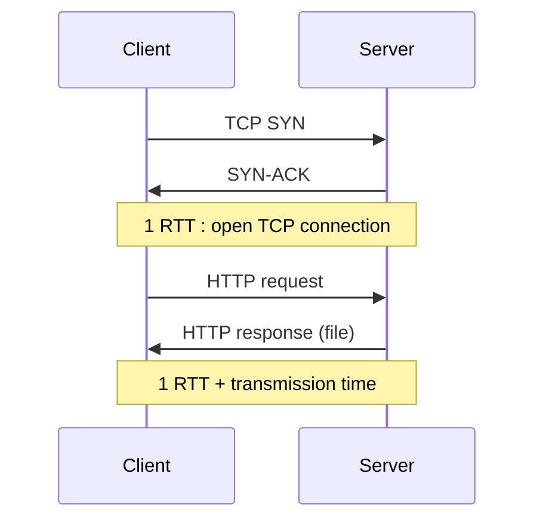

## RTT and response time
**RTT** (Round-Trip Time) : time for a small packet to go client → server → client (processing + queueing + propagation).

Response time for one object = **2 RTT + file transmission time**

## 3 modes
| Mode | How | Cost for N objects |
|---|---|---|
| Non-persistent (HTTP/1.0) | new TCP connection per object, closed after | **2 RTT per object** + OS resources per connection |
| Persistent without pipelining | connection kept open, next request after previous response | 1 RTT per object |
| Persistent with pipelining | requests sent as soon as objects are found | as little as **1 RTT for all** |

Example : base HTML + 10 JPEG
- Non-persistent : 11 × 2 RTT
- Persistent with pipelining : 2 RTT (HTML) + ~1 RTT (10 images)

Pipelining : FIFO in HTTP/1.1 (one slow object blocks the others = head-of-line blocking), asynchronous in HTTP/2.

**Links** : [[HTTP]] [[QUIC]] [[Nodal Delay]]
