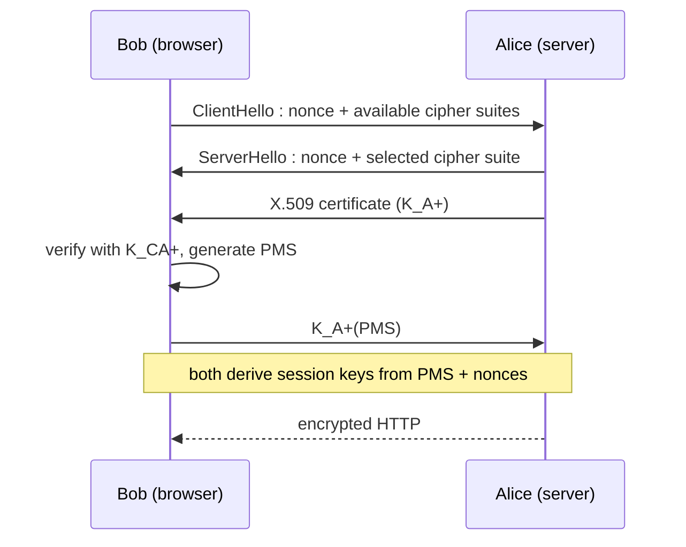

HTTPS = HTTP over **TLS** (Transport Layer Security, ex-SSL) on port 443 → fights phishing by authenticating the server.

## Principle
- The browser embeds the public keys of the [[Certification Authority|CAs]]
- Client and server negotiate a **cipher suite**
- Server sends its X.509 certificate → client checks it with $K_{CA}^+$ and extracts the server key $K_A^+$
- Client generates a **Pre-Master Secret (PMS)**, sends $K_A^+(PMS)$ → seed for encryption keys and MAC

## TLS 1.2 handshake (RFC 5246)

Same idea as the mixed scheme of [[Session Key]] (public key to exchange, then symmetric).

## TLS 1.3 (RFC 8446, 2018)
| TLS 1.2 | TLS 1.3 |
|---|---|
| many cipher suites | reduced list |
| key exchange with RSA (PMS) | Pre-Shared Key or **ECC Diffie-Hellman** |
| 2 RTT handshake | 1 RTT, even **0-RTT** possible (risky : replay) |

**Links** : [[HTTP]] [[Certification Authority]] [[Session Key]] [[QUIC]]
