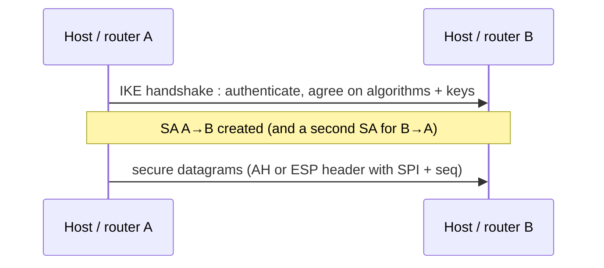

Security **at the network layer** : protects everything above IP.

## 2 goals
1. **Confidentiality** : the sending host encrypts the data of the IP datagram
2. **Authentication** : the destination can authenticate the source IP address

## 2 protocols
| | AH — Authentication Header (RFC 4302) | ESP — Encapsulation Security Payload (RFC 4303) |
|---|---|---|
| Source authentication | yes | yes |
| Data integrity | yes | yes |
| **Confidentiality** | **no** | **yes** |
| IP protocol number | 51 | 50 |
| Fields | next header, SPI, sequence number, authentication data (signature of the datagram) | header : SPI + sequence number ; trailer : next header ; authentication field |

32-bit **sequence number** → prevents replay and person-in-the-middle attacks.

## 2 modes
| Transport mode | Tunnel mode |
|---|---|
| protects the upper-layer payload | protects a whole IP packet, encapsulated in a new one |
| end to end (host ↔ host) | router ↔ router (VPN) |

## Security Association (SA)
Before sending, both ends handshake (IKE, ISAKMP/Oakley) :
- authenticate the endpoints
- choose algorithms and keys
- reset sequence numbers to 0

An SA is :
- **simplex** (one direction only) and logical
- identified by a 3-tuple : (security protocol AH/ESP, source IP, 32-bit **SPI** = Security Parameter Index)
- a "connection" at the network layer → contradicts its connectionless nature

**Links** : [[IPv6]] [[HTTPS and TLS]] [[Session Key]] [[Hash Functions]]
