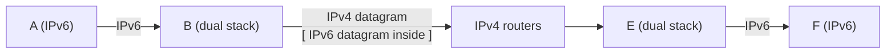

Not all routers can be upgraded at once : **no "flag day"** → IPv4 and IPv6 must coexist.

## Main approaches
| Approach | How | Note |
|---|---|---|
| **Dual stack** | routers / hosts run both IPv4 and IPv6, translate between formats | IPv6-only fields (flow label) are **lost** when converted to IPv4 |
| **Tunnelling** | IPv6 datagram carried as **payload** of an IPv4 datagram between IPv4 routers | |
| DNS64 + NAT64 | gateway lets an IPv6-only client reach an IPv4 server | RFC 6146, 6147 |
| 464XLAT | IPv4 app on an IPv6-only network (e.g. mobile operators) | RFC 6877 |

## Tunnelling

| Type | Encapsulation | Examples |
|---|---|---|
| IPv6 in IPv4 | IPv4 protocol = **41** | manual : 6in4, GRE ; automatic : 6to4, 6rd |
| IPv6 in UDP in IPv4 | NAT-friendly | Teredo, LISP |

## DNS64 + NAT64
- **DNS64** : client asks AAAA, gateway asks A and synthesises an IPv6 address
- **NAT64** : translates IPv6 packets to the IPv4 server

## Status and lesson
- Belnet backbone dual stack since 2003, UNamur since 2009 (2001:6a8:3900::/48)
- Slow adoption ("market failure"?), rising prices of IPv4 addresses
- **Lesson** : very hard to change the network layer, very easy to deploy new applications (changing house foundations vs painting a wall) → ossification

**Links** : [[IPv6]] [[NAT]] [[DNS Records]] [[What is the Internet]]
