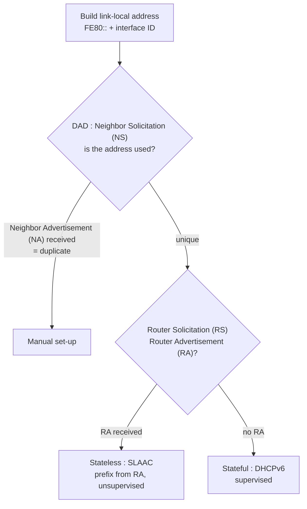

Motivation : IPv4 pool effectively exhausted (announced **3 February 2011**).

## IPv4 vs IPv6 header
| | IPv4 | IPv6 |
|---|---|---|
| Address size | 32 bits | 128 bits |
| Header size | **min 20 bytes**, variable (options) | **fixed 40 bytes** |
| Checksum | yes (recomputed at each hop) | **no** (left to link and transport layers) |
| Fragmentation by routers | yes | **no** (only at the source, via extension) |
| Options | in the header | moved to **extension headers** |
| Flow support | no | **flow label** |
| Next protocol field | Protocol | Next header |

Protocol / next header values : 6 TCP, 17 UDP, 50/51 IPsec, 58 ICMPv6, 89 OSPF.

## Review question : overhead
40 bytes of data every 20 ms, in TCP (20 B header) then IP :

| | Header bytes | Datagram | Overhead | Data |
|---|---|---|---|---|
| IPv4 | 20 + 20 = 40 | 80 B | **50 %** | 50 % |
| IPv6 | 20 + 40 = 60 | 100 B | **60 %** | 40 % |

## Extension headers (chained after the base header)
| Extension | Next header | Read by | Use |
|---|---|---|---|
| Hop-by-hop | 0 | **all** routers | router alert, jumbogram, padding |
| Routing | 43 | listed routers | loose source routing, mobility |
| Fragmentation | 44 | destination | fragmentation done by the source |
| IPsec (ESP / AH) | 50 / 51 | destination | confidentiality, authentication |
| Destination | 60 | destination only | mobility, tunnelling, padding |

## Mobility
Packet sent from the care-of address (CoA) to the correspondent (CN), with a routing extension carrying the home address (HoA) → the connection keeps the same identity while the host moves.

## Address autoconfiguration (SLAAC)

ICMPv6 types : RS 133, RA 134, NS 135, NA 136. DAD = Duplicate Address Detection.

**Links** : [[IP Addressing]] [[IPsec]] [[ICMP]] [[IPv4 to IPv6 Transition]]
