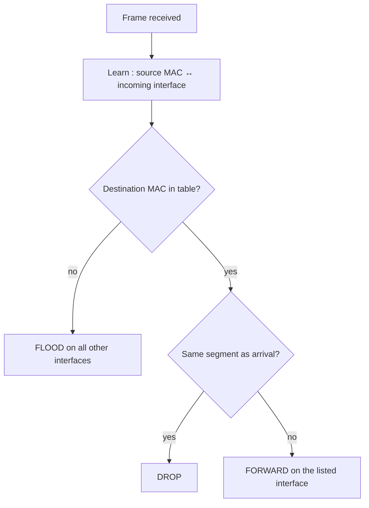

How to interconnect the LANs of several departments? 4 options : **hubs, bridges, switches, routers**.

## Hubs (L1)
Backbone hub joins LAN segments, extends reach (still 100 m between nodes). Drawbacks :
- all collision domains become **one** (three 100 Mbps LANs → one 100 Mbps network)
- can't mix technologies, reach still limited

## Bridges (L2, legacy)
- **Store and forward** Ethernet frames, forward **selectively** by destination MAC → keep **separate collision domains**
- Use CSMA/CD to send on a segment
- **Transparent** (hosts don't see them), **plug-and-play**, self-learning

## Switches (L2)
= multi-interface bridge
- Dedicated full-duplex link per host → A→A' and B→B' **at the same time, no collisions**
- Ethernet **without** carrier sensing or collision detection
- **Cut-through** : start forwarding before the whole frame arrives → lower latency

## Self-learning
Table entry : `(MAC address, interface, timestamp)`, stale entries dropped (TTL ~60 min).
On each received frame, the switch **learns** the sender's MAC and interface.

## Spanning tree
Redundant paths = reliability, but **cycles** → frames multiplied and forwarded forever.
Fix : build a **spanning tree** (loop-free subset of the topology) by disabling some interfaces.

## Switches vs routers
| | Switch | Router |
|---|---|---|
| Layer | L2 (link) | L3 (network) |
| Table | switch table : filtering, learning, spanning tree | forwarding table : routing algorithms |
| Pros | plug-and-play, simple, little processing | any topology, **best path**, stops broadcast storms, loops limited by TTL |
| Cons | traffic stuck on the spanning tree, no protection against **broadcast storms**, huge ARP tables at scale | more processing, needs address **configuration** |
| Scale | small networks (hundreds of hosts) | large networks (thousands) |

## Comparison
| | Hub | Bridge | Switch | Router |
|---|---|---|---|---|
| Layer | L1 | L2 | L2 | L3 |
| Traffic isolation | no | yes | yes | yes |
| Plug-and-play | yes | yes | yes | **no** |
| Optimal routing | no | no | no | **yes** |
| Cut-through | yes | no | yes | no |

**Links** : [[Ethernet]] [[VLAN]] [[Router Architecture]] [[MAC Address and ARP]] [[Local Area Network]]
