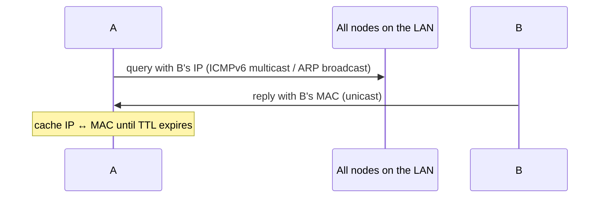

## Two kinds of addresses
| | IP address | MAC (LAN, physical, Ethernet) address |
|---|---|---|
| Size | 128 bits (IPv6), 32 bits (IPv4) | **48 bits**, burned in the adapter ROM |
| Goal | reach the destination **IP network** | go from one interface to another **on the same link** |
| Structure | **hierarchical** → not portable | **flat** → portable |
| Allocation | ISP / registries | IEEE ; a manufacturer buys blocks of 2²⁴ addresses |
| Analogy | postal address (changes) | ID number (permanent) |

## From name to MAC address

## Address resolution : ND (IPv6) and ARP (IPv4)
Each node keeps a table of `<IP address ; MAC address ; TTL>` (TTL typically **20 min**, **soft state**).
Linux : `ip -6 neigh show` (IPv6), `arp -a` (IPv4).

**Plug-and-play** : tables are built without any admin.

## Sending to a node off the LAN (A → B via router R)
| Step | Who | Action |
|---|---|---|
| 1 | A | builds datagram **src A, dst B** (IP), but must give it to R |
| 2 | A | ARP for **R's MAC** (R's interface 111.111.111.110) |
| 3 | A | frame : dst MAC = **R**, payload = A→B datagram |
| 4 | R | extracts datagram, sees dst = B, ARP for **B's MAC** (R has one ARP table per LAN) |
| 5 | R | new frame dst MAC = B, **same** A→B datagram |

IP addresses stay the same end to end, MAC addresses change at every hop.

**Links** : [[IP Addressing]] [[IP Forwarding]] [[ICMP]] [[IPv6]] [[Ethernet]] [[DNS Records]]
