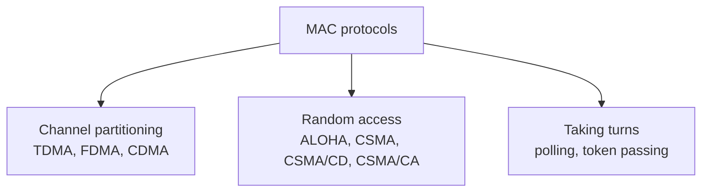

## Two types of links
| Point-to-point | Broadcast (shared medium) |
|---|---|
| PPP (dial-up), switch ↔ host Ethernet | old Ethernet, upstream [[Hybrid Fiber Coax\|HFC]], 802.11 WiFi |
| no access problem | **multiple access problem** : 2+ simultaneous transmissions → **collision** |

## The ideal protocol (channel of rate R)
1. One node active → it sends at **R**
2. M nodes active → each gets **R/M** on average
3. Fully **decentralised** (no single point of failure)
4. Simple and cheap

## 3 families

## Channel partitioning
Split the channel into pieces (time slots, frequencies, codes), one per node.
- Fair : each node gets R/M
- But a single active node **can't use** the empty pieces → R/M is a maximum
- See [[Time Division Multiplexing]], [[Frequency Division Multiplexing]], [[CDMA]]

## Partitioning vs random access
| Load | Channel partitioning | Random access |
|---|---|---|
| Low | inefficient : access delay, 1/N of bandwidth even with one active node | **efficient** : one node uses the whole channel |
| High | **efficient and fair** | collision overhead |

**Taking turns** = try to get the best of both.

## Taking turns
| | Polling | Token passing |
|---|---|---|
| How | a **master** invites slaves one after another | a **token** is passed from node to node |
| Examples | MS/TP building automation (RS-485) | legacy : token bus 802.4, token ring 802.5, FDDI |

| Pros | Cons |
|---|---|
| no collisions | latency (wait for your turn) |
| no empty slots | single point of failure (master or token) |
| | overhead (master election, token generation) |

**Links** : [[Random Access Protocols]] [[CDMA]] [[CSMA-CA]] [[Link Layer Services]]
