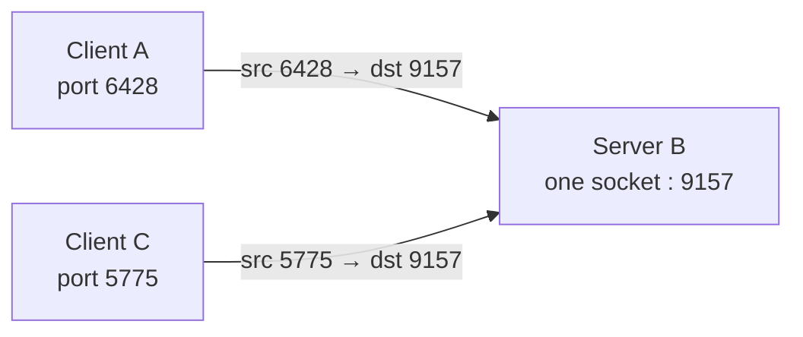
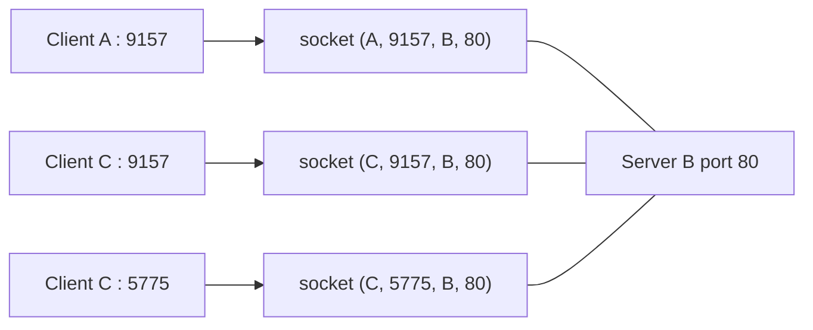

| Multiplexing (sender) | Demultiplexing (receiver) |
|---|---|
| gather data from several [[Socket\|sockets]], add a header | read the header, deliver the segment to the right socket |
| school : collect letters before sending | school : hand out received letters |

## Connectionless (UDP) — 2-tuple
UDP socket identified by **(destination IP, destination port)**.
- Receiver only looks at the destination port
- Segments from **different sources** reach the **same socket**
- Source IP + port are used only as return address

## Connection-oriented (TCP) — 4-tuple
TCP socket identified by **(source IP, source port, destination IP, destination port)**.
- Receiver uses all 4 values
- Server has **one socket per connection** (per process or thread)

Same destination port 80, but 3 different sockets because the 4-tuples differ.

| | UDP | TCP |
|---|---|---|
| Socket ID | 2-tuple | 4-tuple |
| Sockets on server | 1 for all clients | 1 per connection (+ 1 listening) |

**Links** : [[Socket]] [[UDP]] [[TCP Segment Structure]]
