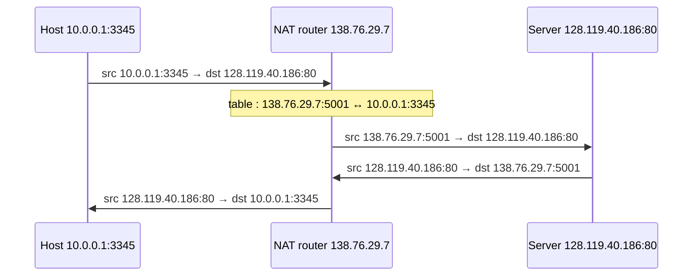

Context : IPv4 address shortage. The whole local network uses **one public IP address** seen from outside (Linux : masquerading + IP forwarding).

## How it works

| Direction | Action |
|---|---|
| Outgoing | replace (source IP, port) by (NAT IP, **new port**), store in the **NAT translation table** |
| Incoming | replace (NAT IP, new port) by the stored (private IP, port) |

> Example addresses are the classic Kurose & Ross figure (the slide is a diagram).

## Pros and cons
| Pros | Cons |
|---|---|
| one address for all devices | routers should stop at layer 3, NAT reads **ports** (layer 4) |
| change local addresses without telling the outside | **violates the E2E principle** |
| change ISP without renumbering devices | inside hosts can't be servers without tricks (passive FTP, STUN, TURN, P2P connection reversal) |
| hides the topology (security plus) | "push" services must poll (RSS) |
| | the real fix is IPv6 |

## Scale
- Residential NAT : 16-bit port field → 60 000+ connections behind one address
- **Carrier-Grade NAT** (RFC 6598) : the ISP itself does NAT, using 100.64.0.0/10 internally

**Links** : [[IP Addressing]] [[DHCP]] [[Multiplexing and Demultiplexing]] [[IPv4 to IPv6 Transition]]
