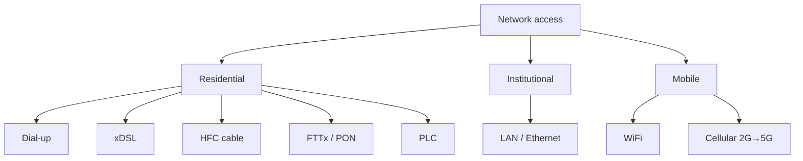

Physical link connecting an end system to its **edge router**.

## Three categories
1. Residential : dial-up, [[xDSL]], [[Hybrid Fiber Coax|HFC]] (cable), [[Fiber To The x|FTTx]], PLC
2. Institutional (school, company) : [[Local Area Network|LAN]]
3. Mobile : [[Wireless access networks]]

## Dial-up modem (legacy)
- MOdulates digital → analog over the phone line, DEModulates back
- Max 56 kbps (~8 min for a 3-min MP3)
- Can't phone and surf at the same time, "always on" too expensive
- → replaced by **broadband** (xDSL, HFC, FTTx), always on

## Power Line Communications (PLC)
Shared Internet access through existing electrical outlets

**Links** : [[Physical Media]] [[The Network edge]]
