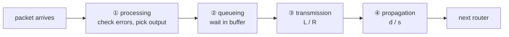

If the packet arrival rate exceeds the output link capacity, packets **queue** in the output buffer and can ultimately be **dropped** ([[Packet Loss]]).

## 4 types of delay (per node)
$d_{nodal} = d_{proc} + d_{queue} + d_{trans} + d_{prop}$

| Delay | What | Value |
|---|---|---|
| Processing | check bit errors, choose output link | µs |
| [[Queueing Delay\|Queueing]] | wait for the link, depends on the number of packets ahead | 0 → ∞ (drop), typically 1 µs–1 ms |
| Transmission | push all bits into the link | **L / R** (L = packet length, R = bandwidth) |
| Propagation | one bit travels the link | **d / s** (d = length, s ≈ 2–3·10⁸ m/s) |

⚠️ Transmission ≠ propagation : one depends on packet size & bandwidth, the other on distance.

## Caravan analogy
- Car = bit, caravan = packet, toll booth = router (store and forward)
- 10 cars, booth = 12 s/car, 100 km at 100 km/h : 10 × 12 s (trans) + 3600 s (prop) = 62 min
- If the booth is slower (60 s/car) and cars faster (1000 km/h) : 600 + 360 s = 16 min → the first cars reach the next booth before the last ones leave the previous one

## E2E delay (ideal case)
N links, N−1 routers, no congestion (no queueing) :
$d_{E2E} = N \, (d_{proc} + d_{trans} + d_{prop})$
Real case → measured with [[Traceroute]].

**Links** : [[Packet Switching]] [[Queueing Delay]] [[Packet Loss]]
