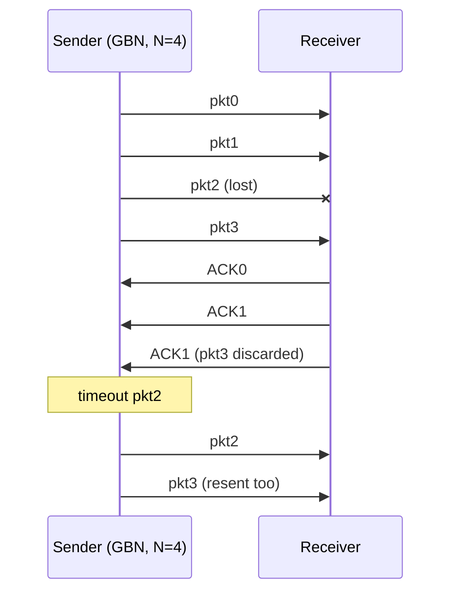

## Why : Stop-and-Wait wastes the link
1 Gbps link, 15 ms propagation (RTT = 30 ms), 1 kB packet :
- Transmission L/R = 8 µs ≪ RTT
- Sender utilisation : $U = \frac{L/R}{RTT + L/R} = \frac{0.008}{30.008} = 0.00027$
- → 1 kB every 30 ms = **267 kbps** on a 1 Gbps link

**The protocol, not the link, limits performance.**

## Pipelining
Several **in-flight**, not-yet-ACKed packets :
- larger range of sequence numbers
- buffers at sender and/or receiver
- 3 packets in flight → $U = \frac{3 L/R}{RTT + L/R} = 0.00081$ (×3)

## Go-Back-N vs Selective Repeat
| | Go-Back-N | Selective Repeat |
|---|---|---|
| Window | up to N unACKed packets (k-bit seq → $2^k$ numbers) | N consecutive sequence numbers |
| ACK | **cumulative** ACK(n) = all up to n | **individual** ACK per packet |
| Timer | on the oldest unACKed packet | one per unACKed packet |
| On timeout(n) | resend n **and all higher** packets in window | resend **only** n |
| Out-of-order at receiver | **discarded**, re-ACK last in-order (duplicate ACKs) | **buffered** until gap filled |
| Receiver buffer | none | yes |
| Drawback | one error → many retransmissions | more complex, more buffers |

## Window-size dilemma (SR)
2-bit numbers (0–3), window = 3 : the receiver can't tell a **new** pkt0 from a **retransmitted** old pkt0 → accepts duplicate as new.
Rule : $2^{k-1} \geq$ window size, i.e. window ≤ half the sequence space.

## ARQ summary
| Stop-and-Wait | Go-Back-N | Selective Repeat |
|---|---|---|
| 1 packet in flight | several, possibly repeated | several, only originals resent |

**Links** : [[Reliable Data Transfer]] [[TCP Reliable Data Transfer]] [[Packet Switching]]
