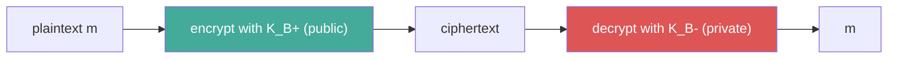

Alice fetches Bob's **public key** $K_B^+$ and encrypts with it ; Bob decrypts with his **private key** $K_B^-$. No shared secret.

## Two requirements
1. $K_B^-(K_B^+(m)) = m = K_B^+(K_B^-(m))$
2. Impossible to derive $K_B^-$ from $K_B^+$

## Drawbacks
- Enables **chosen plaintext attacks** (anyone can encrypt messages)
- Owning the key no longer authenticates the sender
- Slow (mathematical functions) → used to exchange a [[Session Key]]
- How to be sure a public key really belongs to Bob? → [[Certification Authority]]

## Algorithms
- 1st generation : [[RSA]] (factorisation)
- 2nd generation : [[Elliptic Curve Cryptography|ECC]] (discrete logarithm)

## Symmetric vs public key
| | Symmetric | Public key |
|---|---|---|
| Secret | shared by both | private key known only by receiver |
| Issue | agree on the key first | trust the public key |
| Based on | substitutions & permutations | mathematical functions |

**Links** : [[Symmetric Key Cryptography]] [[RSA]] [[Elliptic Curve Cryptography]]
