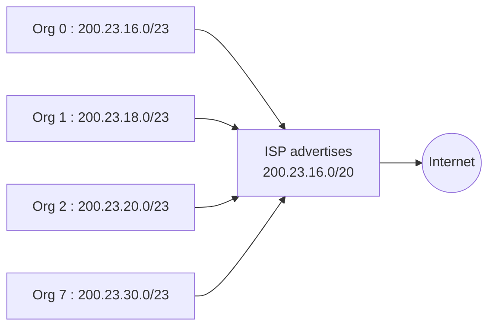

## Who gives prefixes?
IANA → regional registries (RIR) → ISPs → customers. Prefixes are allocated to **maximise route aggregation**.

| Strategy | Who owns the prefix | When changing ISP |
|---|---|---|
| Provider provisioning (PP / PA) | the ISP | **renumbering** of the customer's network |
| Provider Independent (PI) | the customer | **routing update** : the new ISP must advertise a specific route |

## Route aggregation
Hierarchical addressing → one ISP advertises **one** short prefix covering all its customers.

## With a PI prefix
Org 1 moves to ISP 2 but keeps its prefix :
- ISP 1 still advertises 200.23.16.0/20
- ISP 2 advertises the more specific 200.23.18.0/23
- Routers use **longest match prefix** → traffic for Org 1 goes to ISP 2

> Addresses in the example are the classic Kurose & Ross figure (the slide is a diagram).

**Links** : [[IP Addressing]] [[IP Forwarding]] [[BGP]]
