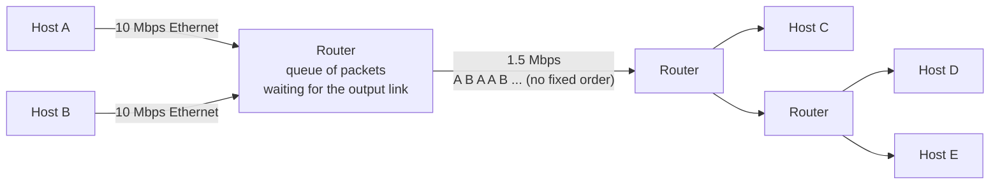

The sequence of packets from different users follows no fixed pattern (opposite to [[Time Division Multiplexing|TDM]]) : packets are sent whenever they are ready.

- Packets of A and B share the 1.5 Mbps link **on demand**, in the order they arrive
- Inputs faster than the output → a **queue** builds up → [[Queueing Delay]], possibly [[Packet Loss]]

**Links** : [[Packet Switching]] [[Time Division Multiplexing]] [[Frequency Division Multiplexing]]
