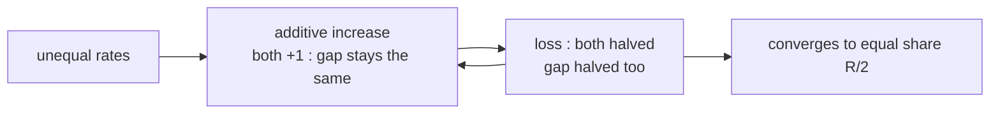

Goal : K TCP sessions on the same bottleneck link of rate R → each gets **R / K**.

## Why AIMD is fair
Two connections start with different rates :

On a plot of throughput 1 vs throughput 2 : increase moves along a 45° line, decrease moves towards the origin → the point converges to the **equal bandwidth share** line.

## Limits of fairness
| UDP | Parallel TCP connections |
|---|---|
| apps that don't want to be throttled use UDP at constant rate | nothing stops an app from opening many connections (web browsers do) |
| no congestion control → unfair to TCP | link R with 9 connections : new app with 1 TCP gets R/10, with 9 TCPs gets R/2 |
| fix : DCCP, TCP-Friendly Rate Control (TFRC) | |

**Links** : [[TCP Congestion Control]] [[UDP]]
