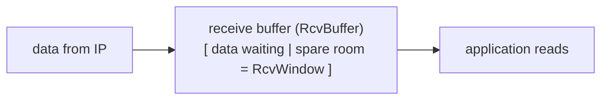

**Speed matching** : the sender must not overflow the **receiver's buffer** by sending too much, too fast (the receiving app may read slowly).

- $RcvWindow = RcvBuffer - (LastByteRcvd - LastByteRead)$
- Receiver advertises RcvWindow in every segment (receive window field)
- Sender keeps **unACKed data ≤ RcvWindow** → buffer never overflows
- RcvWindow = 0 → sender stops, but sends small **probes** to avoid a deadlock (otherwise it would never learn the window reopened)

## Flow control vs congestion control
| Flow control | Congestion control |
|---|---|
| protects the **receiver** | protects the **network** |
| window from the receiver (RcvWindow) | window estimated by the sender (CongWin) |

Sender actually sends $\min(RcvWindow, CongWin)$.

**Links** : [[TCP Segment Structure]] [[TCP Congestion Control]] [[The Network edge]]
