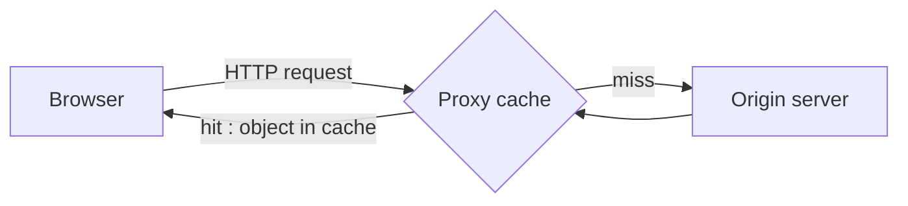

Goal : satisfy the client request **without** involving the origin server. The cache (proxy) is both a **client and a server**.

**Middlebox** (RFC 3234) : any intermediary device doing more than standard IP routing (cache, firewall, NAT).

## Benefits
| For whom | Benefit |
|---|---|
| End user | shorter response time |
| Institution | less traffic on the access link |
| "Poor" content provider | can deliver content effectively |

- Freshness check with Conditional GET (`If-modified-since`, see [[HTTP]])
- Dilemma : deliver without checking? → heuristics

## Example
15 requests/s × 100 kbits = 1.5 Mbps ; Internet round trip = 2 s ; access link 1.5 Mbps.

| Option | Access link use | Total delay |
|---|---|---|
| Nothing | 100 % | ms + **minutes** + 2 s |
| Upgrade link to 10 Mbps (expensive) | 15 % | ms + ms + 2 s |
| Cache with hit rate 0.4 (cheap) | 60 % | 0.4 × 1 ms + 0.6 × (2 s + 10 ms) ≈ **1.2 s** |

→ The cache is cheaper **and** faster than upgrading the link.

**Links** : [[HTTP]] [[Content Distribution Network]] [[Queueing Delay]]
