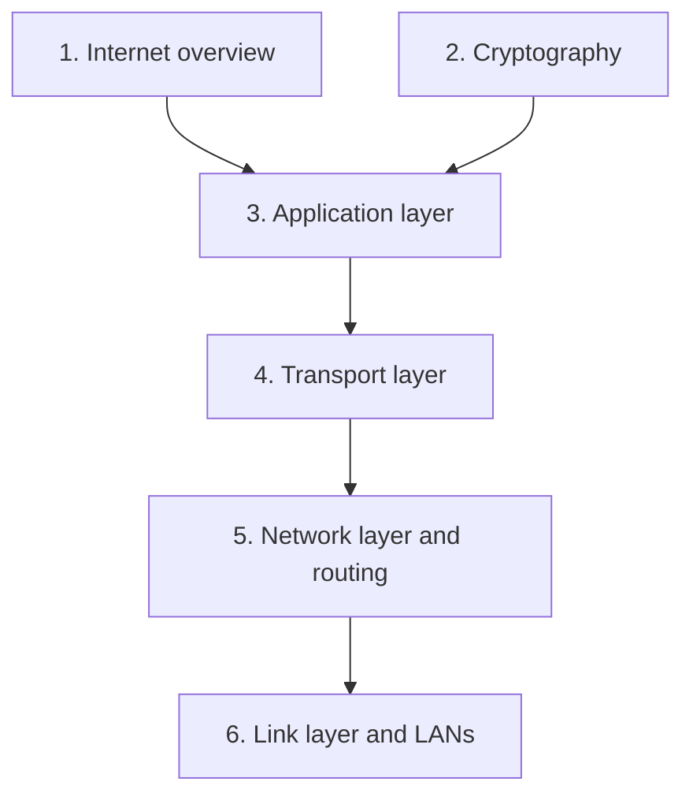

## Course map

## Key concepts
**Basics** : [[What is the Internet]] · [[What is a Protocol]] · [[Packet Switching]] · [[Circuit Switching]] · [[Nodal Delay]] · [[Internet Protocol Stack]]

**Security** : [[Symmetric Key Cryptography]] · [[Public Key Cryptography]] · [[Hash Functions]] · [[Certification Authority]] · [[HTTPS and TLS]]

**Application** : [[HTTP]] · [[DNS]] · [[Electronic Mail]] · [[Content Distribution Network]] · [[Peer-to-Peer]]

**Transport** : [[UDP]] · [[TCP Segment Structure]] · [[Reliable Data Transfer]] · [[TCP Congestion Control]] · [[QUIC]]

**Network** : [[Network Layer Services]] · [[IP Addressing]] · [[IPv6]] · [[NAT]] · [[Routing Algorithms]] · [[Autonomous Systems]] · [[BGP]]

**Link** : [[Link Layer Services]] · [[Error Detection]] · [[Multiple Access Protocols]] · [[Random Access Protocols]] · [[MAC Address and ARP]] · [[Ethernet]] · [[Link Layer Switches]]
